
   </a> </a> 

# MemProcFS-Analyzer
MemProcFS-Analyzer.ps1 is a PowerShell script utilized to simplify the usage of MemProcFS and to optimize your memory analysis workflow.

MemProcFS - The Memory Process File System by [Ulf Frisk](https://x.com/ulffrisk)  
https://github.com/ufrisk/MemProcFS  

Features:
* Fast and easy memory analysis!
* Graphical User Interface (GUI) or Command-Line Interface (CLI)
* Windows PowerShell 5.1 and PowerShell 7 Support
* Easy Configuration via Config.json (e.g. Modules Selection, Process Whitelist, Excel Color Scheme)
* You can mount a memory snapshot (Raw Physical Memory Dump or Microsoft Crash Dump) like a disk image and handle the memory compression feature on Windows
* Auto-Install of MemProcFS, AmcacheParser, AppCompatCacheParser, Elasticsearch, entropy, EvtxECmd, ImportExcel, IPinfo CLI, jq, Kibana, lnk_parser, RECmd, SBECmd, xsv, YARA, and Zircolite  
* Auto-Update of MemProcFS, AmcacheParser, AppCompatCacheParser, Elasticsearch, entropy, EvtxECmd (incl. Maps), ImportExcel, IPinfo CLI, jq, Kibana, lnk_parser, RECmd, SBECmd, xsv, YARA, and Zircolite   
* Update-Info when there's a new version of ClamAV or a new Dokany File System Library Bundle available  
* Pagefile Support
* OS Fingerprinting  
* Scan w/ Custom YARA rules (incl. 803 rules by e.g. [Chronicle](https://github.com/chronicle/GCTI/tree/main/YARA) and [Elastic Security](https://github.com/elastic/protections-artifacts))  
* Multi-Threaded scan w/ ClamAV for Windows (incl. PUA Detection)   
* Collection of infected files detected by ClamAV for further analysis (PW: infected)
* Collection of injected modules detected by MemProcFS PE_INJECT for further analysis (PW: infected)
* FindEvil Alerts for Injected Code and Injected Encrypted Payloads (e.g. sleeping Cobalt Strike Beacons)
* Extracting IPv4/IPv6  
* IP2ASN Mapping and GeoIP w/ [IPinfo CLI](https://github.com/ipinfo/cli) &#8594; Get your token for free at [https://ipinfo.io/signup](https://ipinfo.io/signup)  
* Checking for Suspicious Port Numbers
* [Process Tree](https://github.com/LETHAL-FORENSICS/MemProcFS-Analyzer/wiki/Process-Tree) (TreeView) including complete Process Call Chain (Special thanks to [Dominik Schmidt](https://github.com/DaFuqs))
* Checking Processes for Unusual Parent-Child Relationships and Number of Instances  
* Checking WmiPrvSE.exe for Parent Process Anomalies 
* Checking Processes for Unusual User Context
* Checking for Process Path Masquerading and Process Name Masquerading (Damerau Levenshtein Distance)
* Web Browser History (Google Chrome, Microsoft Edge and Firefox) 
* Extracting Windows Event Log Files and processing w/ EvtxECmd &#8594; Timeline Explorer ([EZTools](https://ericzimmerman.github.io/) by Eric Zimmerman) 
* Event Log Overview  
* Processing Windows Event Logs w/ [Zircolite](https://github.com/wagga40/Zircolite) - A standalone SIGMA-based detection tool for EVTX (incl. Zircolite Viewer)
* Analyzing extracted Amcache.hve and Amcache SQLite Databases (Inventory*.db) w/ AmcacheParser ([EZTools](https://ericzimmerman.github.io/) by Eric Zimmerman)   
* Analyzing Application Compatibility Cache aka ShimCache w/ AppCompatCacheParser ([EZTools](https://ericzimmerman.github.io/) by Eric Zimmerman)  
* Analyzing Syscache w/ RECmd ([EZTools](https://ericzimmerman.github.io/) by Eric Zimmerman)  
* Analyzing UserAssist Artifacts w/ RECmd ([EZTools](https://ericzimmerman.github.io/) by Eric Zimmerman)  
* Analyzing ShellBags Artifacts w/ RECmd ([EZTools](https://ericzimmerman.github.io/) by Eric Zimmerman)  
* Simple Prefetch View (based on Forensic Timeline)  
* Analyzing Auto-Start Extensibility Points (ASEPs) w/ RECmd ([EZTools](https://ericzimmerman.github.io/) by Eric Zimmerman)  
* Analyzing RecentDocs, Office Trusted Document w/ RECmd ([EZTools](https://ericzimmerman.github.io/) by Eric Zimmerman)  
* Analyzing Registry w/ DFIR RECmd Batch File ([DFIR Batch File](https://github.com/EricZimmerman/RECmd/blob/master/BatchExamples/DFIRBatch.md) by Andrew Rathbun)  
* Analyzing Metadata of Recovered Process Modules (experimental)  
* Extracting Windows Shortcut Files (LNK)  
* Hunting Malicious Windows Shortcut Files (LNK)
* Integration of PowerShell module [ImportExcel](https://github.com/dfinke/ImportExcel) by Doug Finke
* CSV output data for analysis w/ Timeline Explorer (e.g. timeline-reverse.csv, findevil.csv, web.csv)  
* Collecting Evidence Files (Secure Archive Container &#8594; PW: MemProcFS)  
* and much more

## Download 
Download the latest version of **MemProcFS-Analyzer** from the [Releases](https://github.com/LETHAL-FORENSICS/MemProcFS-Analyzer/releases) section.  

## Usage  
Launch Windows PowerShell 5.1 or PowerShell 7 (or Windows PowerShell ISE or Visual Studio Code) as Administrator and open/run MemProcFS-Analyzer.ps1.  

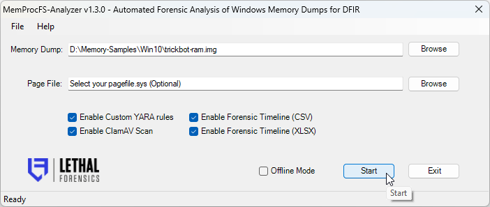  
**Fig 1:** Select your Memory Dump (Raw or Crash Dump) and select your pagefile.sys (Optional)

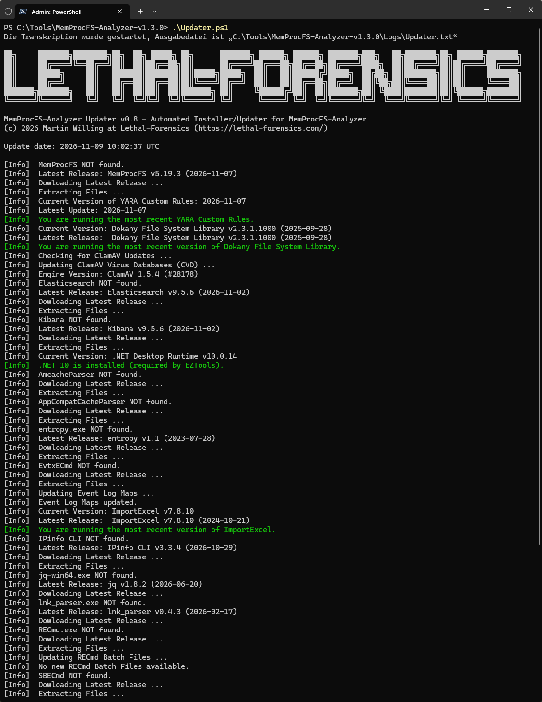  
**Fig 2:** MemProcFS-Analyzer auto-installs dependencies (First Run)

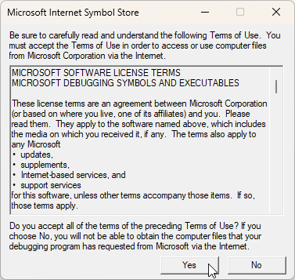  
**Fig 3:** Accept Terms of Use (First Run)  

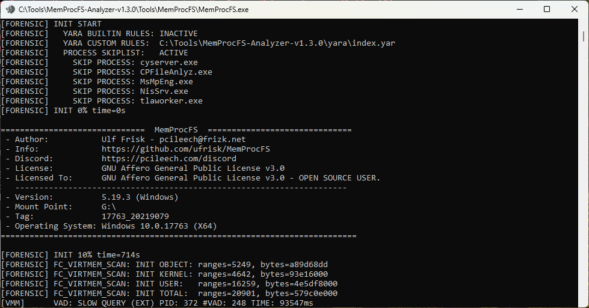  
**Fig 4:** If you find MemProcFS useful, please become a sponsor at: https://github.com/sponsors/ufrisk  

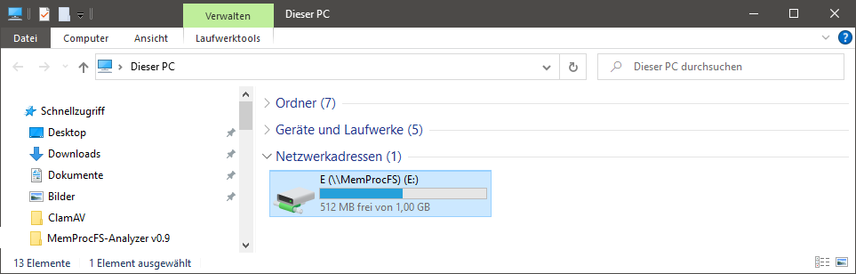  
**Fig 5:** You can investigate the mounted memory dump by exploring drive letter

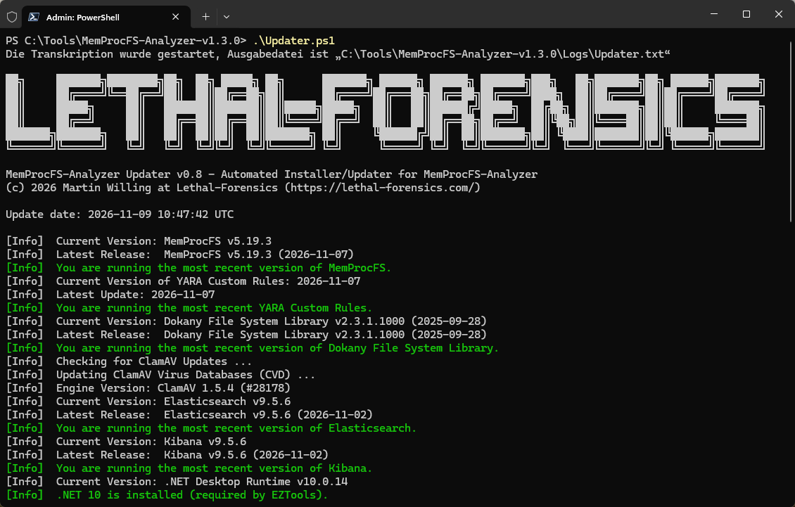  
**Fig 6:** MemProcFS-Analyzer checks for updates (Second Run)  

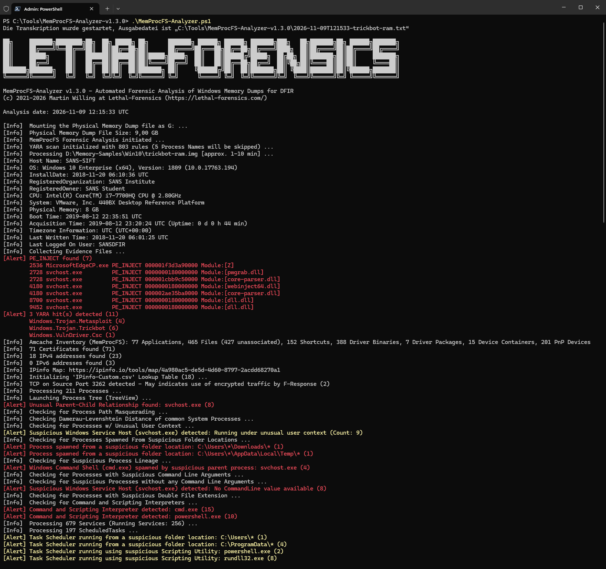  
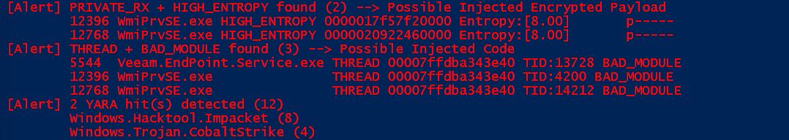
**Fig 7:** FindEvil feature and additional analytics

  
**Fig 8:** Processes

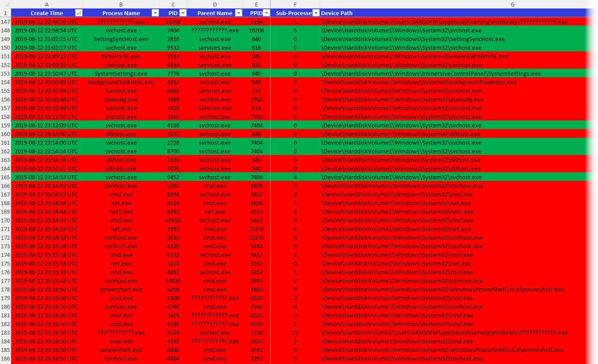  
**Fig 9:** Running and Exited Processes

  
**Fig 10:** Process Tree (GUI)

  
**Fig 11:** Checking Process Tree (to find anomalies)

  
**Fig 12:** Process Tree: Alert Messages w/ Process Call Chain

  
**Fig 13:** Process Tree: Properties View &#8594; Double-Click on a process or alert message

  
**Fig 14:** GeoIP w/ IPinfo.io

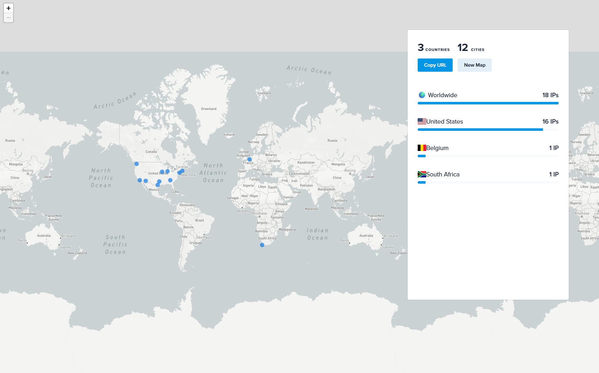  
**Fig 15:** Map IPs w/ IPinfo.io

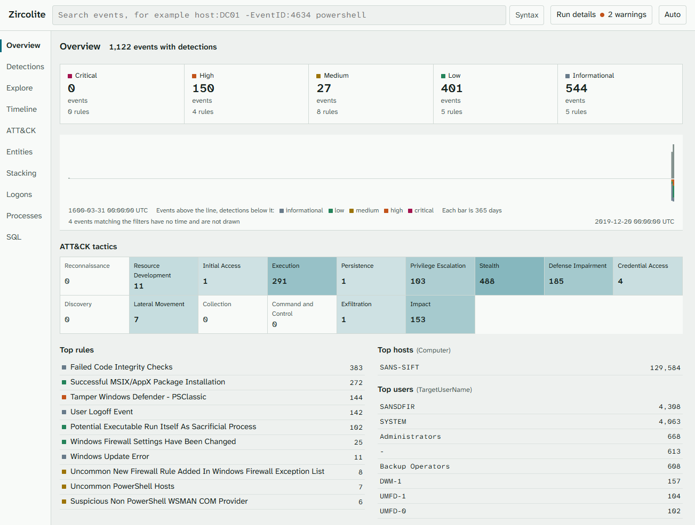  
**Fig 16:** Zircolite - A standalone SIGMA-based detection tool for EVTX  

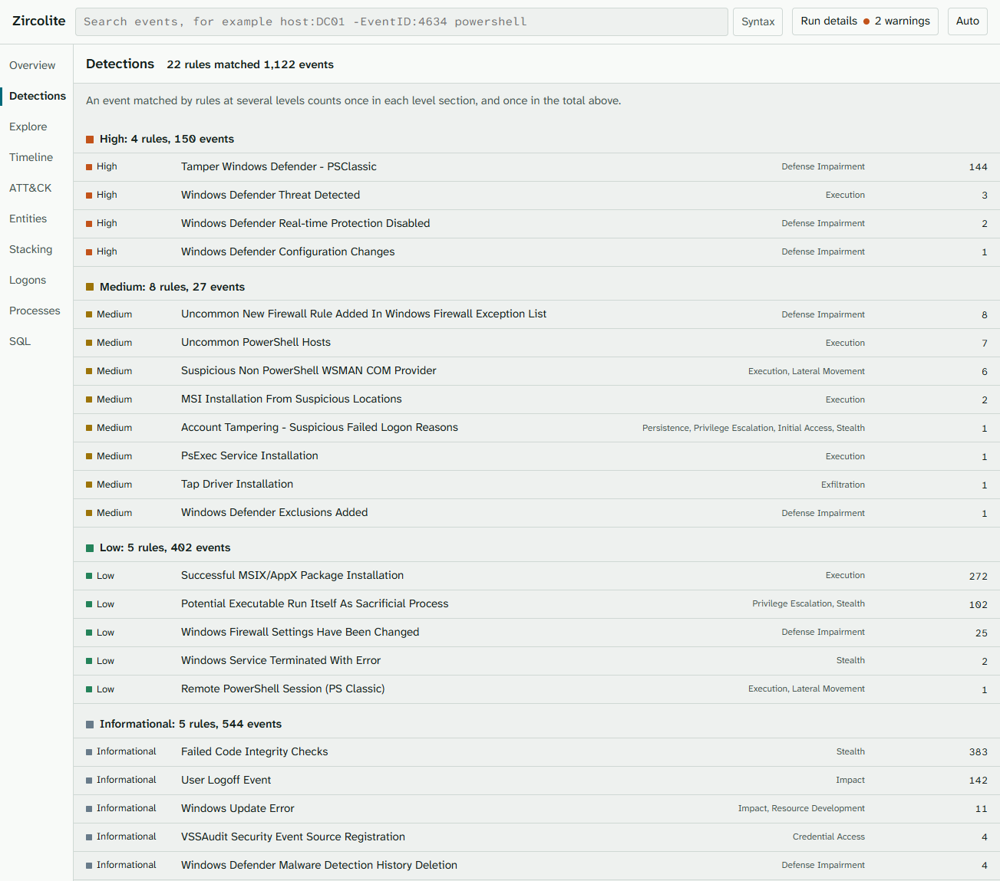  
**Fig 17:** ZZircolite Viewer  

  
**Fig 18:** Processing extracted Amcache.hve &#8594; XLSX  

  
**Fig 19:** Processing ShimCache &#8594; XLSX  

  
**Fig 20:** Analyze CSV output w/ Timeline Explorer (TLE)

  
**Fig 21:** ELK Import

  
**Fig 22:** Happy ELK Hunting!

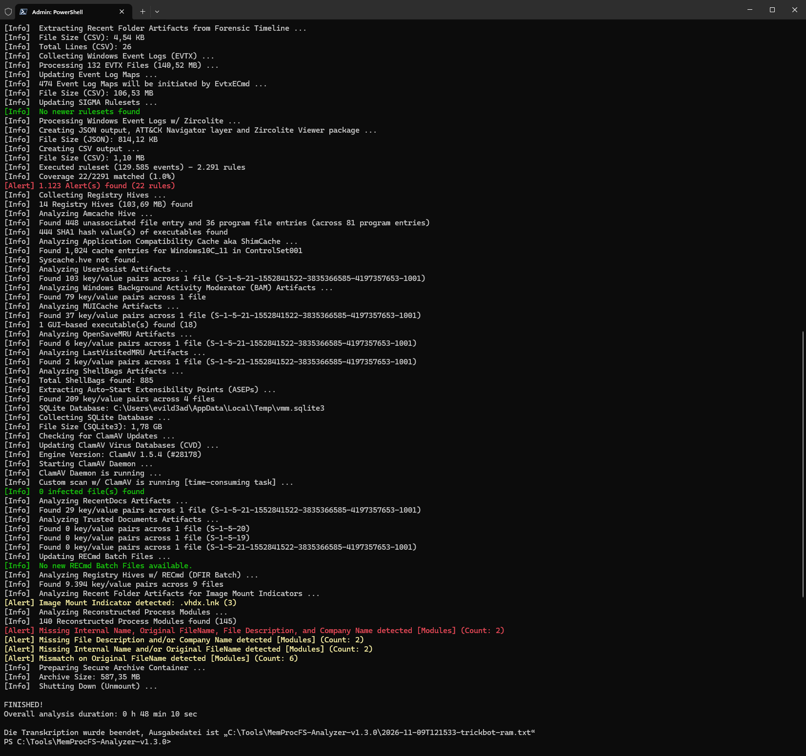  
**Fig 23:** Multi-Threaded ClamAV Scan to help you finding evil! ;-)

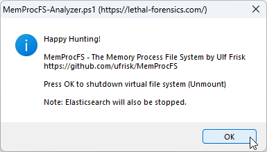  
**Fig 24:** Press **OK** to shutdown MemProcFS and Elastisearch/Kibana

  
**Fig 25:** Secure Archive Container (PW: MemProcFS)  

## Command-Line Usage  
MemProcFS-Analyzer can also be launched from the command line (without GUI). If -Memory is not specified, the Graphical User Interface (GUI) will be launched.  

| Parameter | Alias | Description |
|---|---|---|
| -Memory | -MemoryDump, -m | Raw Physical Memory Dump or Microsoft Crash Dump |
| -Pagefile | -p | pagefile.sys (Optional) |
| -Yara | | Enable Custom YARA rules (yara\index.yar) |
| -ClamAV | | Enable ClamAV Scan |
| -TimelineCSV | | Enable Forensic Timeline (CSV) |
| -TimelineXLSX | | Enable Forensic Timeline (XLSX) |
| -OfflineMode | | Offline Mode |
| -OutputDir | -o | Output Directory (Optional). Default: Script Directory. Will be created if it does not exist. |

Examples:  
`.\MemProcFS-Analyzer.ps1`  
`.\MemProcFS-Analyzer.ps1 -Memory "E:\MemoryDump.bin" -Pagefile "E:\pagefile.sys" -Yara -ClamAV -OfflineMode`  
`.\MemProcFS-Analyzer.ps1 -Memory "E:\MemoryDump.bin" -Yara -ClamAV -OutputDir "E:\MemProcFS-Analyzer"`  

Show all parameters and examples:  
`Get-Help .\MemProcFS-Analyzer.ps1 -Full`     

## Introduction MemProcFS and Memory Forensics  
Check out [Super Easy Memory Forensics](https://www.slideshare.net/IIJ_PR/super-easy-memory-forensics) by [Hiroshi Suzuki](https://twitter.com/herosi_t) and [Hisao Nashiwa](https://twitter.com/unk0unk0).

## Prerequisites 
1. Download and install the latest Dokany Library Bundle &#8594; DokanSetup.exe  
https://github.com/dokan-dev/dokany/releases/latest  

2. Download and install the latest .NET 10 Desktop Runtime (Requirement for [EZTools](https://ericzimmerman.github.io/))  
https://dotnet.microsoft.com/en-us/download/dotnet/10.0  

3. Download and install the latest Windows package of ClamAV.  
https://www.clamav.net/downloads#otherversions 

4. First Time Set-Up of ClamAV  
Launch Windows PowerShell console as Administrator.  
`cd "C:\Program Files\ClamAV"`  
`copy .\conf_examples\freshclam.conf.sample .\freshclam.conf`  
`copy .\conf_examples\clamd.conf.sample .\clamd.conf`  
`write.exe .\freshclam.conf`  &#8594; Comment or remove the line that says "Example".  
`write.exe .\clamd.conf` &#8594; Comment or remove the line that says "Example".  
https://docs.clamav.net/manual/Usage/Configuration.html#windows  

5. Optimize ClamAV scan speed performance (30% faster)  
Open "C:\Program Files\ClamAV\clamd.conf" with your text editor (as Administrator) and search for: "Don't scan files and directories matching regex"    
`ExcludePath "\\heaps\\"`  
`ExcludePath "\\handles\\"`  
`ExcludePath "\\memmap\\vad-v\\"`  
`ExcludePath "\\sys\\pool\\"`  

6. Enable PUA (Possibly Unwanted Applications) detection in ClamAV (Optional)  
Launch Windows PowerShell console as Administrator.  
`cd "C:\Program Files\ClamAV"`  
`write.exe .\clamd.conf` &#8594; Search for "#DetectPUA yes" and remove the "#".  
`DetectPUA yes`  
PUA detections (e.g. hacktools, password tools, remote access tools) are reported as a separate alert and saved to "ClamAV\Infected\PUA.txt".  
https://docs.clamav.net/faq/faq-pua.html  

7. Create your free IPinfo account [approx. 1-2 min]  
https://ipinfo.io/signup?ref=cli  
Open "Config.json" with your text editor, search for "AccessToken" and replace "access_token" with your access token.

8. Enable (true) or disable (false) the optional analysis modules you want to play with in "Config.json" (Section: "Modules"). Elasticsearch and ELKImport are disabled by default.   

9. Launch the Automated Installer/Updater for MemProcFS-Analyzer  
`.\Updater.ps1`  

10. Install Python 3.x (and check the box "Add Python 3.x to PATH").  
Install dependencies for Zircolite:  
`cd .\Tools\Zircolite`  
`python -m pip install --upgrade pip`  
`python -m pip install -r requirements.txt`  

11. Done! :smiley:   

Notes: 
- Turn off your antivirus protection temporarily or better exclude your MemProcFS-Analyzer directory from scanning (e.g. Zircolite).  
- [Elasticsearch Tips](https://github.com/LETHAL-FORENSICS/MemProcFS-Analyzer/wiki/Elasticsearch)

## Dependencies
1768.py v.0.0.23 (2025-03-07)  
https://blog.didierstevens.com/?s=1768.py  

7-Zip 26.05 Standalone Console (2026-10-21)  
https://www.7-zip.org/download.html  

AmcacheParser v2026.10.1.0 (.NET 10)  
https://ericzimmerman.github.io/  

AppCompatCacheParser v2026.10.1.0 (.NET 10)  
https://ericzimmerman.github.io/  

ClamAV - Download &#8594; Windows &#8594; clamav-1.5.4.win.x64.msi (2026-08-07)  
https://www.clamav.net/downloads    

Dokany Library Bundle v2.3.1.1000 (2025-09-28)  
https://github.com/dokan-dev/dokany/releases/latest &#8594; DokanSetup.exe  

Elasticsearch 9.5.6 (2026-11-02)  
https://www.elastic.co/downloads/elasticsearch  

entropy v1.1 (2023-07-28)  
https://github.com/merces/entropy  

EvtxECmd v2026.10.2.0 (.NET 10)  
https://ericzimmerman.github.io/  

ImportExcel v7.8.10 (2024-10-21)   
https://github.com/dfinke/ImportExcel  

IPinfo CLI 3.3.4 (2026-10-29)    
https://github.com/ipinfo/cli  

jq v1.8.2 (2026-06-20)  
https://github.com/stedolan/jq  

Kibana 9.5.6 (2026-11-02)  
https://www.elastic.co/downloads/kibana  

lnk_parser v0.4.3 (2026-02-17)  
https://github.com/AbdulRhmanAlfaifi/lnk_parser  

MemProcFS v5.19.3 - The Memory Process File System (2026-11-07)  
https://github.com/ufrisk/MemProcFS  

RECmd v2026.10.3.0 (.NET 10)  
https://ericzimmerman.github.io/  

SBECmd v2026.10.3.0 (.NET 10)  
https://ericzimmerman.github.io/  

xsv v0.13.0 (2018-05-12)  
https://github.com/BurntSushi/xsv  

YARA v4.6.0 (2026-10-27)  
https://virustotal.github.io/yara/  

Zircolite v4.7.1 (2026-11-02)  
https://github.com/wagga40/Zircolite  

## Links
[MemProcFS](https://github.com/ufrisk/MemProcFS)  
[Demo of MemProcFS with Elasticsearch](https://www.youtube.com/watch?v=JcIlowlrvyI)  
[Sponsor MemProcFS Project](https://github.com/sponsors/ufrisk)  
[MemProcFS-Plugins](https://github.com/ufrisk/MemProcFS-Plugins)  
